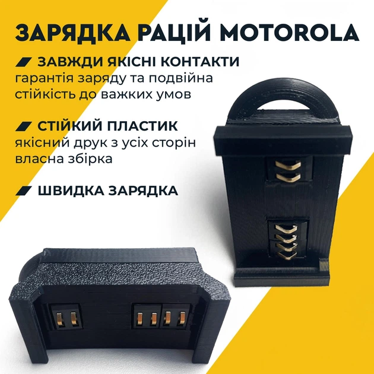

# Full specification (English)

**For the student guys — 21.05.2026**

A few tasks that I could somehow hand over to you:

1. Soldering something very simple: wires, small devices, and so on.
2. Repairing things I can't fix quickly myself.
3. A box charging station for drone-operator posts.

:::info[About this translation]

This page is a proofread English translation of the Ukrainian document _«Хлопцям Студентам 21,05,2026»_. The texts marked "from the Ukrainian product page" are translated from the Ukrainian pages in [Simple products](../simple-products/readme.md), because the document itself shows only photos for those items.

:::

## Contents

- [Problem](#problem)
- [Goal](#goal)
- [Motivation](#motivation)
- [Simple but necessary](#simple-but-necessary)
- [Directions](#directions)
  - [1. "Frog"](#1-frog)
  - [2. Frog 2.0 (TBD)](#2-frog-20-tbd)
  - [3. "Power banks"](#3-power-banks)
  - [4. "USB to XT60"](#4-usb-to-xt60)
  - [5. "Spider"](#5-spider)
- [The "Physicist" box](#the-physicist-box)
- [Team](#team)
- [What was done](#what-was-done)
- [Why this is realistic](#why-this-is-realistic)
- [Inventory list](#inventory-list)

## Problem

There are very few engineers in the army, even though this is now effectively a drone war. Engineers are the bottleneck of this war.

Right now my engineer:

- solders Starlinks;
- converts satellite communication systems to work with Starlink;
- adds a Raspberry Pi to them;
- builds "sparky" (paired setups) for aerial reconnaissance posts;
- repairs ground robotic systems (UGVs);
- does small repairs.

He also wants to eat and sleep every day.

## Goal

Build a strong network of people who are "in peaceful life" — in calm conditions — and can work systematically and steadily.

By distributing tasks and people, we will be able to move forward steadily.

## Motivation

### Why

Because the front needs cheap, repairable and expendable energy solutions.

EcoFlow is expensive. Sometimes a 649-euro station lives on a position for only a month.

### How

Through:

- reuse;
- repair;
- R&D;
- local production;
- a veteran team;
- an international volunteer network.

## Simple but necessary

### 1. Extension cables for charging stations

For example, I have charging stations for charging the large "Vampire" batteries. They have a very short power cable and a short balance lead. In war conditions this is very inconvenient. Right now I have 6 of these stations, plus three more stations with other connectors.

To solder an extension cable, you have to order components from three different shops, wait until everything arrives at Nova Poshta, and only then solder.

I could take 12 of these extension cables for power and balance leads right now, and they would go straight into use.

Or we could make, for example, 20 of them and give the rest to other units that also have "Vampires".

More details: [Extension cables for charging stations](../simple-products/wire-extenders/readme.md).

### 2. Basic repair of equipment and EcoFlows that have broken down or whose batteries have run out of life

1. There was a power box for EW (electronic warfare) equipment. Something went wrong and it doesn't work. We took it apart and it turned out that several wires had simply been ripped out during a fast move. I hadn't seen how it worked before that, so now I have to sit down, take time away from the "Vampires" and test this thing. Or the battery has gone completely flat, and you have to pull out the parts and replace everything.
2. There is a guy who repairs EcoFlows. The ones that are too expensive to repair because of "dead" batteries, he buys up for parts. So he has a lot of plastic housings, power management boards, ports and other components. I can simply buy a few of these housings and send them to you — maybe something can be built from them.
3. There are many examples like this.

## Directions

### 1. "Frog"

_From the Ukrainian product page:_ Motorola never thought their radios would be used like this. So they made the radio charge from 220 V through a "cup" that the whole radio is put into — similar to how electric toothbrushes charge. That doesn't work here. So this device appeared: an adapter from the radio to Type-C.

It lets our guys charge radios from power banks.

Volume: 40 pieces would go into use straight away. These have to be made all the time. The boards have to be ordered from abroad in advance, on a regular basis. A stock of 200 pieces would already cover several months ahead.

Ready-made ones sell for 200–400 UAH. For example, I could easily hand out 40 of them to infantry companies.

[Frog adapter on Rozetka](https://rozetka.com.ua/ua/522259339/p522259339)

More details: [Frog v1](../simple-products/frog-version-one/frog-v1.md).

### 2. Frog 2.0 (TBD)

_From the Ukrainian product page:_ A very interesting device that is very hard to find right now. It is the same Frog, but besides Type-C it has a step-down converter and an XT60 output. This device would let you charge a radio from an FPV battery.

An example of how a "Vampire" crew works is given below. But for our infantry to have radio communication, they have to charge their radios. For that they need power banks.

Besides the power bank, you need a cable to connect the power bank and the radio.

If we make a device that can charge from an FPV battery, we can essentially do without the power bank and its wires.

Instead of dropping a power bank, an FPV battery or something similar goes into the parcel.

Then, when we take the cells out of the FPV batteries and put them into the cases the Dutch buy on AliExpress, we are doing "dumb" (simple) work — provided we have plenty of these devices.

More details: [Frog 2.0](../simple-products/frog-version-two/frog-version-two-ua.md) (Ukrainian).

### 3. "Power banks"

There is also a need to solder and assemble simple products — for example, power banks for the infantry.

In the Netherlands there are a lot of electric bicycles, and a lot of used batteries from them. They could be brought here, taken apart into cells, tested here, and assembled into single-use power banks.

#### Example of use

Every night the "Vampires" deliver parcels to the infantry.

Every parcel contains a power bank.

An ordinary power bank costs at least 1400 UAH. But at the front it is effectively single-use:

- the infantry charge a radio from it;
- after that, the power bank is often simply thrown away.

Recently the Dutch gave us 47 of these used power banks. I gave them to an infantry company.

For them this means:

- big savings;
- a free solution for the army;
- a way to cover the basic need for power.

Yes, these power banks aren't perfect. They break quickly. But the main thing is — they work.

More details: [Power banks](../simple-products/powerbanks/pb.md) (Ukrainian).

### 4. "USB to XT60"

_From the Ukrainian product page:_ A small, cheap device — a stopgap for when there are no Frogs and so on. It turns an FPV battery into a power bank. The design is already proven: there is a parts list, a 3D design, and so on.

[100 W XT30/XT60 to 2× USB-A + 2× USB-C converter (FlashArmy)](https://flasharmy.com.ua/peretvoriuvach-zhyvlennia-100w-xt30-xt60-2x-usb-a-2x-usb-c-001)

[XT60 to USB-C cable on Rozetka](https://rozetka.com.ua/ua/454488674/p454488674/)

[XT60 to USB Type-C PD 65 W adapter for 3S–7S FPV batteries, with voltmeter (VADS)](https://vads.com.ua/adapter-xt60-usb-type-c-pd-65w-blok-zhyvlennia-vid-fpv-akumuliatora-3s7s-z-voltmetrom/)

[Power adapter for 3–8S FPV batteries: XT60, 4× USB, 1× Type-C, DC 5.5×2.1 mm (Hazardous)](https://hazardous.com.ua/blok-zhyvlennia-perekhidnyk-vid-fpv-akumuliatora-3-8s-xt60-4-usb-1-type-c-dc-5.52.1-mm)

[XT60-to-USB adapter on Rozetka](https://rozetka.com.ua/ua/510712939/p510712939/)

More details: [USB to XT60](../simple-products/usb-to-xt60/usb-to-xt60.md).

### 5. "Spider"

_From the Ukrainian product page:_ The "Spider" is an indispensable thing on a position when you work with a radio. The problem is that buying them all the time is expensive. The system is very simple — it is just a coaxial cable of a certain length that extends the radio's antenna. So you can keep the radio in the dugout, throw the Spider up onto a tree, and the quality of the connection goes up.

When signallers, EW operators and pilots are being taken out by guided aerial bombs (KABs) and FPV drones, it is hard to keep communication at a constant level, because everything can fail.

As I said, this system is very simple. To make it by hand you need almost nothing. You buy connectors, a reel of this coaxial cable, a crimping tool — and it already works.

_From the Ukrainian product page:_ videos by the Russians:

- [YouTube video 1](https://www.youtube.com/watch?v=ES4G9ZNl-_M)
- [YouTube video 2](https://www.youtube.com/watch?v=1AUsnAfmH-E)

More details: [Spider](../simple-products/spider/spider.md) (Ukrainian).

## The "Physicist" box

This idea is already about a year old. There is a lot of information and a lot of material, but very little progress.

### Concept

- a case from a Mavic 3T drone;
- 3–4 FPV batteries inside;
- a control board / charging board;
- a laptop power supply;
- a HOTA GaN USB hub with XT60;
- a cooler (fan);
- a power button.

The HOTA GaN is the most expensive part of this case. It works well and solves many problems with one device.

Link: [HOTA P24 PD charger](https://pyrodrone.com/products/hota-p24-pd-charger-248w-usb-w-xt60-input-grey)

So even just to supply our posts with these charging stations, we need to make at least 10 boxes. And they have to be made now, so that they are ready.

### Reason

Volunteers from Germany raise money for an EcoFlow for us, which costs 649 euros. But on some posts these charging stations live a month at most. Then the Russians take the post apart, the guys have to run, and they leave the heavy equipment behind to survive.

### How it works now

Right now the Germans buy us new EcoFlows.

Then:

1. They are sent to the Netherlands, where we have a logistics hub.
2. Then everything is loaded into the car of our "smuggler" — a military chaplain.
3. He brings it into Ukraine.
4. Next, in Chernivtsi, there is the logistics hub of a Ukrainian foundation.
5. There everything is repacked and sent to different units.

### How it could be

Instead of ready-made EcoFlows, we buy:

- a batch of wires;
- the boards we need;
- Mavic cases;
- electronics;
- components.

All of this goes to Ukraine, and here we assemble the finished solutions and distribute them between units.

### Scale of the problem

Our unmanned systems company now has 9 posts. My platoon already has two posts, and that's not the limit.

One of my "Vampire" posts is about 2300 euros of equipment. And that is without the "Vampire" batteries and without the "Vampire" drone itself. Posts can be lost, and all the equipment with them.

### Additional use

These boxes could also be handed out to the homes where soldiers live — as large power banks for backup power.

#### We have various volunteers

Recently they ordered us about 500 euros' worth of various boards and wires, so we could "play around" and do R&D for the first of these boxes.

I have been collecting information on this topic for more than a year. So far we only have the first prototype. Maybe the second one will be ready in a few days.

An example of a case for powering EW equipment that a friend of mine from Kharkiv made for us:

## Team

I have three wounded brothers-in-arms for whom I want to find work in this project.

### Mr. "Physicist"

PhD in physics. Chief engineer of an FPV unit.

Two years ago his legs were smashed. Now he hardly goes far from home.

### Mr. "Owl"

My navigator. Lost an arm after an FPV drone hit my car.

### Mr. "Forester"

My engineer and sapper. He took the wounding of "Owl" very hard psychologically.

All of them are very smart guys. They all have experience, resources and motivation. But they still live the war in their heads, and right now they are doing almost nothing.

If this box "takes off", I want to try to build a veteran business where the margin goes:

- to the needs of my unit;
- to paying for their work.

For communication — Slack or Signal, where there are already people from different countries.

## What was done

What we have now:

- the idea;
- FPV batteries;
- 2 built charging stations (version 0);
- a HOTA GaN charging hub;
- Mavic cases.

## Why this is realistic

The most expensive part of all this is the batteries. But if there is an FPV unit nearby, there are enough batteries.

### What it looks like

- newcomers were training at a range;
- they crashed into a tree;
- the battery is damaged;
- it can no longer deliver the current to start the motors.

Or:

- there was a voltage spike during charging;
- one cell died;
- the battery is no longer fit for flight.

Batteries like these are written off. But they can be:

- taken apart;
- have their contacts cleaned;
- re-soldered;
- reassembled for other tasks.

### Another example

There are drones that the brigade bought in a large batch.

But the Russians in our sector have already learned to jam them on their radio frequencies. The FPV pilots tried to use them in combat — they don't reach the target.

We stop using them, and they just lie in a shed.

Meanwhile, their batteries degrade while stored at full charge.

## Inventory list

A list of what is needed to start the project:

- electric bicycle batteries;
- BMS boards;
- wiring;
- USB modules;
- XT60 connectors;
- housings;
- Mavic cases;
- charging boards;
- soldering equipment;
- cell testers;
- power supplies;
- coolers (fans);
- soldering consumables.

All of this would let us start assembling:

- power banks;
- field charging stations;
- small energy solutions for FPV and the infantry.

## Related pages

- [Box "Physics" (English)](../charging-station/physicist.md) · [Ящик «Фізика» (українською)](../charging-station/physicist-ua.md)
- [Simple products](../simple-products/readme.md)
- [Dmytro's notes (English)](../Kyiv-Mohyla-Academy/Dmytro-en.md)
